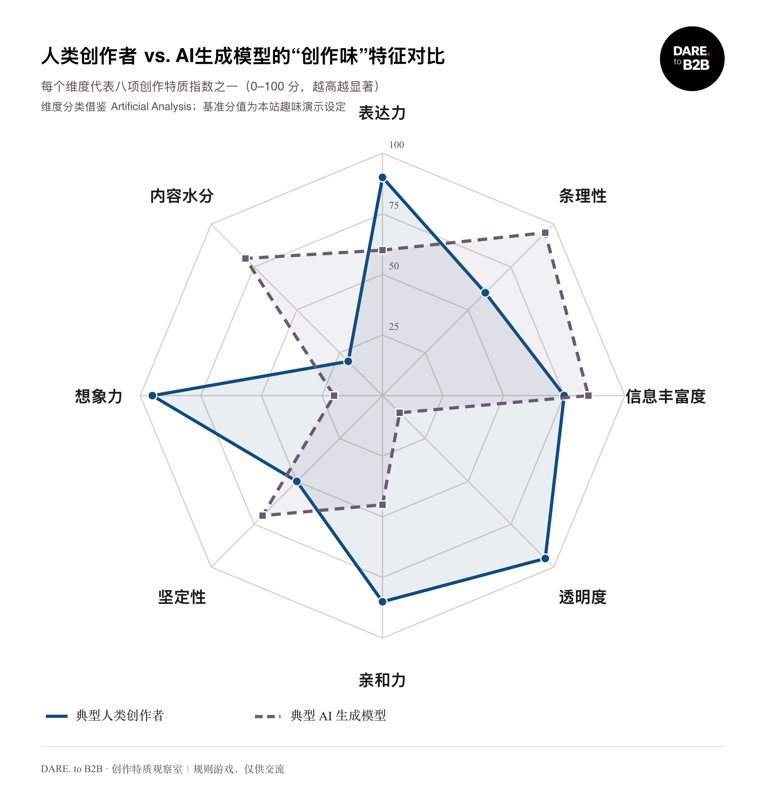

# 创作味｜Dare to B2B · Creation Taste

[English](#english) · [中文](#中文)

## English

**Creation Taste** is a single-file HTML, CSS, and vanilla JavaScript app. It shows an eight-dimension illustrative comparison of human and AI-generated writing, then applies local text-feature rules to an article you provide so a team can talk about the difference before production.

**[Open the live site](https://dare-creation-taste-lab.trafly.chatgpt.site/)** or download `index.html` and open it locally. No backend, installation, or runtime dependencies are required.

### Why this exists

When a draft is still in review, it helps to have a common way to talk about how human writing and model writing tend to differ. This lab is a taste and calibration space for that conversation: illustrative profiles, local rule scores, and a chart a group can look at together.

Judgment comes before generation here. The app does not write the article, and the scores are not an AI detector. They give a team something concrete to discuss at a review gate — which traits stand out, how the draft sits against the reference profiles, and what still needs a person to decide.

### Standard feature chart

[High-resolution PNG (2400×2520)](assets/standard-features.png) · [Vector SVG (1200×1260)](assets/standard-features.svg)

| Dimension | Human reference | AI reference |
| --- | ---: | ---: |
| Expressiveness | 90 | 60 |
| Organization | 60 | 95 |
| Information richness | 75 | 85 |
| Transparency | 95 | 10 |
| Warmth | 85 | 45 |
| Assertiveness | 50 | 70 |
| Imagination | 95 | 20 |
| Fluff | 20 | 80 |

These values are **illustrative baselines chosen for this app**, not measured population averages. The dimension labels draw on Artificial Analysis; this project is not affiliated with that organization.

### Features and limits

- Paste an article or import TXT, Markdown, and some text-based PDFs.
- Estimate eight scores with local text rules and compare them with the two reference profiles.
- Review a six-column comparison table and export SVG or 2400×2520 PNG.
- Scanned PDFs and PDFs with complex font encodings may need OCR or manual text extraction first.

**Disclaimer:** This is a writing self-check and conversation game. Its percentages cannot identify an author and are not suitable for academic-integrity or legal decisions. Preset percentages are reference profiles; running the analyzer recalculates scores from the current text.

### License recommendation and current status

Project concept and brand credit: **Fei Shen | Dare to B2B**. When sharing, please cite the project title, creator, and repository link.

For software redistribution **with the copyright and license notice retained**, **MIT License** is a straightforward choice. It does not require a visible “thanks to the author” message in the app. For the chart and explanatory text, **CC BY 4.0** is an option if you want explicit credit, a license link, and change notices for reuse. See the [OSI MIT license](https://opensource.org/license/mit/) and [Creative Commons BY 4.0 summary](https://creativecommons.org/licenses/by/4.0/).

**No license has been added to this repository yet; these are recommendations only.** The HTML and chart embed the official DARE. to B2B logo, and presets contain article excerpts. Rights to reuse the brand name, logo, and article content must be confirmed with their respective rights holders. A software license does not automatically grant rights to trademarks or brand assets. Before applying a license, confirm the asset permissions and explicitly exclude or separately license those materials.

---

## 中文

一个纯 HTML、CSS、原生 JavaScript 的单文件应用：展示人类创作者与 AI 生成文本的八维“创作味”演示画像，并用词面规则给粘贴的文章打分，方便在定稿前一起讨论差异。

**[打开在线版](https://dare-creation-taste-lab.trafly.chatgpt.site/)** · 下载 `index.html` 后也可离线双击运行，无须安装依赖或配置后端。

### 它为什么存在

草稿还在审阅时，团队需要一种共同的说法，来讨论人类写作和模型写作通常差在哪里。这个实验室想提供那份共同参照：演示画像、本机规则分数，以及可以一起看的图。

这里优先的是判断，不是生成。应用不会写文章，分数也不是 AI 检测结果，不能指认作者。它们只是审阅闸门上的一块讨论材料：哪些特质比较突出、草稿和参考画像差在哪里、还有哪些地方需要人来决定。

### 标准特征图解

[下载高清 PNG（2400×2520）](assets/standard-features.png) · [下载矢量 SVG（1200×1260）](assets/standard-features.svg)

| 特质维度 | 人类演示基准 | AI 演示基准 |
| --- | ---: | ---: |
| 表达力 | 90 | 60 |
| 条理性 | 60 | 95 |
| 信息丰富度 | 75 | 85 |
| 透明度 | 95 | 10 |
| 亲和力 | 85 | 45 |
| 坚定性 | 50 | 70 |
| 想象力 | 95 | 20 |
| 内容水分 | 20 | 80 |

这些分值是本站为图解设定的**演示基准**，不是人类或模型的实测均值。维度分类借鉴 Artificial Analysis 的创作特质标签；本站与该机构无隶属关系。

### 功能与边界

- 粘贴正文，或导入 TXT、Markdown 和部分含可选文字的 PDF。
- 用词面规则估算八维分数，并与两组演示基准绘制三方雷达图。
- 查看六列指标对比表，导出 SVG 或 2400×2520 PNG。
- PDF 扫描件和复杂字体编码文件可能无法读取；请先提取文字或进行 OCR。

**免责声明：**这是写作自测与交流用的趣味游戏。百分比不能识别真实作者，不具备学术检测或法律证明效力。三个预设样例的百分比是参考画像；点击“开始八维趣味鉴定”会根据当前正文重新评分。

### 许可建议与当前状态

项目构思与品牌署名：**申飞｜Dare to B2B**。转载时建议注明项目名称、作者及仓库链接。

如果希望他人**保留作者署名和许可声明后**复制、修改、再分发代码，建议选择 **MIT License**。MIT 要求在软件副本或实质部分中保留版权声明和许可文本；它不要求在界面上写“感谢作者”。如果希望图解、说明文字的转载明确署名、附许可链接并标注修改，可另为这些非代码内容选择 **CC BY 4.0**。参见 [OSI 的 MIT 条款](https://opensource.org/license/mit/) 与 [Creative Commons BY 4.0 条款摘要](https://creativecommons.org/licenses/by/4.0/)。

**目前仓库尚未添加许可证，上述仅为建议。** `index.html` 和图解内嵌 DARE. to B2B 官方 Logo，预设中含文章样例。品牌名称、Logo 和文章内容的再使用权须由相应权利人确认；代码许可不能自动授予商标或品牌素材的使用权。正式添加许可前，应先确认这些素材的授权范围，并在许可文件或权利说明中明确排除或单独授权。
